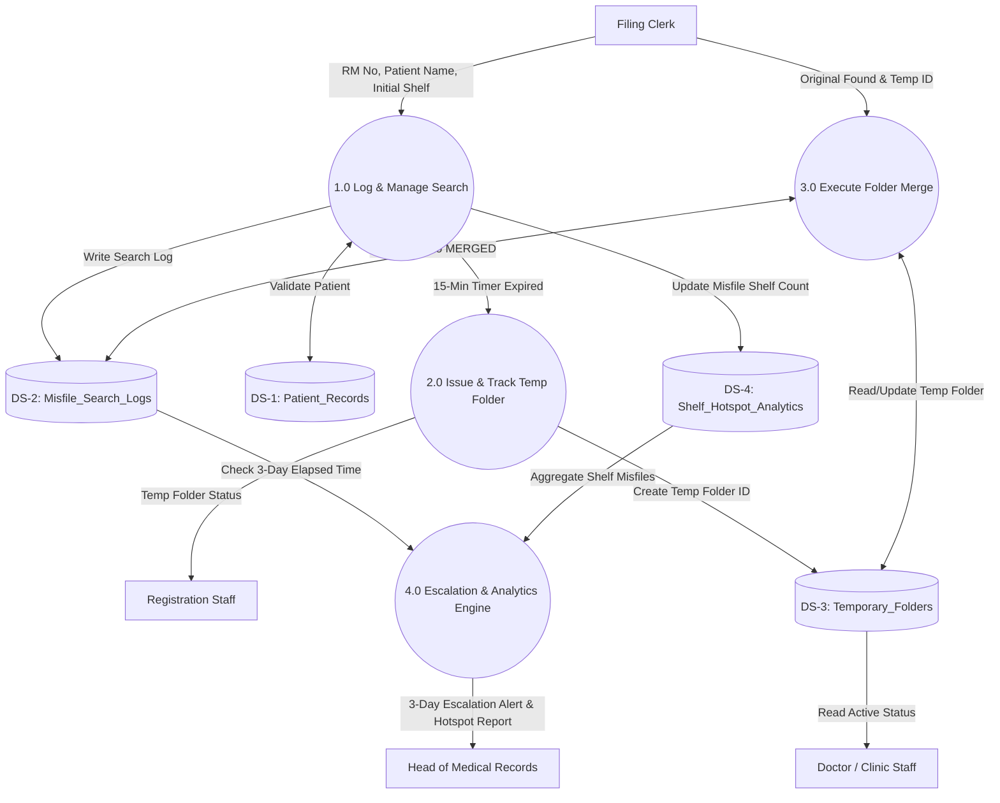

# Part B.3: Data Flow Diagram - Level 1 Diagram

**Case Code:** KJ101-02  
**System Name:** RS Islam Al-Hikmah Misfile & Folder Tracking System  

---

## 1. Level 1 Processes & Data Stores Overview

The Level 1 DFD decomposes the system into four main balanced processes and four core data stores:

### Processes:
* **1.0 Log & Manage Search:** Captures missing folder reports, manages the 15-minute search timer, and records search locations.
* **2.0 Issue & Track Temporary Folder:** Automatically triggers temp folder creation after 15 minutes, assigns Temp Folder IDs, and tracks building movement.
* **3.0 Execute Folder Merge:** Guided consolidation of temporary folder contents with original folders when found.
* **4.0 Escalation & Analytics Engine:** Audits unresolved searches against the 3-day threshold and aggregates misfile shelf hotspots.

### Data Stores:
* **DS-1: Patient_Records** (Patient demographic & master RM metadata)
* **DS-2: Misfile_Search_Logs** (Active and resolved search logs, search durations, initial & found locations)
* **DS-3: Temporary_Folders** (Temporary folder IDs, issuance timestamps, active status)
* **DS-4: Shelf_Hotspot_Analytics** (Shelf numbers, misfile frequencies, building tags)

---

## 2. Level 1 DFD Diagram

---

## 3. Data Flow Balance & Consistency Checklist

| Process | Inputs | Outputs | Balanced Data Store Interaction |
|---|---|---|---|
| **1.0 Log Search** | FC Search Details, DS-1 Patient Data | DS-2 Search Log Entry, DS-4 Shelf Count, 15-Min Timer to P2 | Reads DS-1, Writes DS-2 & DS-4 |
| **2.0 Issue Temp** | 15-Min Trigger from P1 | DS-3 Temp Folder Record, RS Status Notification, DOC View | Writes DS-3, Updates Status |
| **3.0 Merge Folders** | FC Merge Request, DS-3 Temp Record | DS-3 Archived Status, DS-2 Merged Status | Updates DS-2 & DS-3 |
| **4.0 Escalation** | DS-2 Unresolved Logs (>3 Days), DS-4 Shelf Data | Escalation Alert & Shelf Hotspot Report to HOD | Reads DS-2 & DS-4 |
