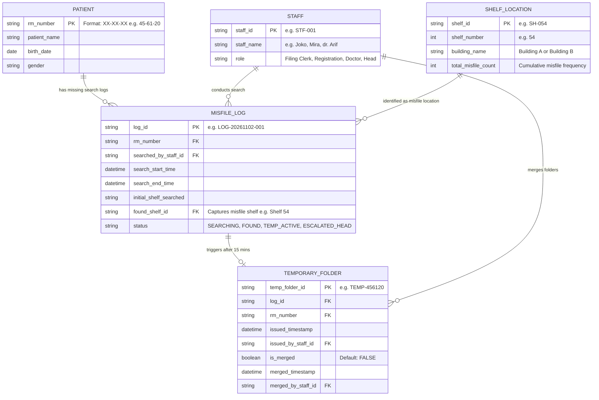

# Part B.4: Entity Relationship Diagram (ERD)

**Case Code:** KJ101-02  
**Database Name:** `db_misfile_tracking_rke517`  

---

## 1. Entity Overview & Data Store Alignment

The ERD contains 5 core entities designed to map directly to the DFD data stores and capture all operational constraints from the four case files, including the extra requirement from the staff chat (`04_Staff_Chat.png`) regarding **Shelf Misfile Tracking**.

### Entities:
1. `PATIENT` (Maps to DFD DS-1): Stores master patient information and primary Medical Record (RM) number.
2. `STAFF` (Auxiliary Entity): Stores filing clerks, registration staff, doctors, and supervisors.
3. `MISFILE_LOG` (Maps to DFD DS-2): Records missing-folder search events, timestamps, initial search shelves, and resolution statuses.
4. `TEMPORARY_FOLDER` (Maps to DFD DS-3): Tracks temporary folder IDs issued after 15 minutes of unsuccessful searching.
5. `SHELF_LOCATION` (Maps to DFD DS-4): Master table of shelf numbers (e.g., Shelf 45, Shelf 54) and building locations to compute shelf misfile hotspots.

---

## 2. ERD Diagram (Mermaid)

---

## 3. Detailed Data Dictionary & Schema Constraints

### Table: `PATIENT`
* `rm_number` (VARCHAR(10), PK): Unique primary medical record number (e.g., `45-61-20`).
* `patient_name` (VARCHAR(100)): Full name of patient (e.g., `Ratna`).
* `birth_date` (DATE): Date of birth.
* `gender` (VARCHAR(10)): `Male` / `Female`.

### Table: `STAFF`
* `staff_id` (VARCHAR(10), PK): Unique staff identifier.
* `staff_name` (VARCHAR(100)): Employee full name.
* `role` (VARCHAR(30)): `FILING_CLERK`, `REGISTRATION`, `DOCTOR`, `HEAD_OF_RM`.

### Table: `SHELF_LOCATION`
* `shelf_id` (VARCHAR(10), PK): Unique shelf ID (e.g., `SH-054`).
* `shelf_number` (INT): Numeric shelf identifier (e.g., `54`).
* `building_name` (VARCHAR(50)): Physical location (`Building A` / `Building B`).
* `total_misfile_count` (INT): Aggregated counter for shelf hotspot analytics.

### Table: `MISFILE_LOG`
* `log_id` (VARCHAR(20), PK): Search event tracking ID.
* `rm_number` (VARCHAR(10), FK -> `PATIENT.rm_number`).
* `searched_by_staff_id` (VARCHAR(10), FK -> `STAFF.staff_id`).
* `search_start_time` (DATETIME): Search initiation timestamp.
* `search_end_time` (DATETIME, NULLABLE): Resolution timestamp.
* `initial_shelf_searched` (VARCHAR(50)): Intended shelf location (e.g., `Shelf 45`).
* `found_shelf_id` (VARCHAR(10), FK -> `SHELF_LOCATION.shelf_id`, NULLABLE): Actual location where folder was found (e.g., `SH-054`).
* `status` (VARCHAR(20)): `SEARCHING`, `FOUND`, `TEMP_ACTIVE`, `ESCALATED_HEAD`, `MERGED`.

### Table: `TEMPORARY_FOLDER`
* `temp_folder_id` (VARCHAR(20), PK): Unique temporary folder code (e.g., `TEMP-456120`).
* `log_id` (VARCHAR(20), FK -> `MISFILE_LOG.log_id`).
* `rm_number` (VARCHAR(10), FK -> `PATIENT.rm_number`).
* `issued_timestamp` (DATETIME): Created after 15 minutes of searching.
* `issued_by_staff_id` (VARCHAR(10), FK -> `STAFF.staff_id`).
* `is_merged` (BOOLEAN): `TRUE` when combined with original, `FALSE` when pending.
* `merged_timestamp` (DATETIME, NULLABLE): Timestamp of merge execution.
* `merged_by_staff_id` (VARCHAR(10), FK -> `STAFF.staff_id`, NULLABLE).
