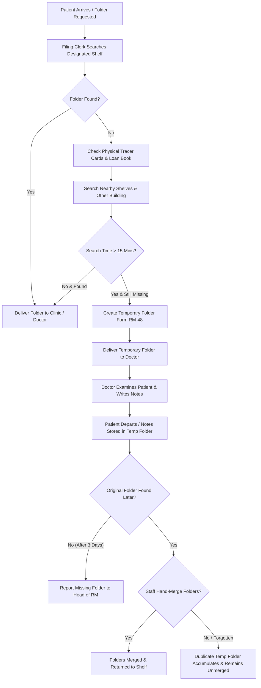

# Part B.1: AS-IS Operational Flowmap

**Case Code:** KJ101-02  
**Hospital:** RS Islam Al-Hikmah, Bogor  

---

## 1. Description of Today's Work Process (AS-IS)

Currently, at RS Islam Al-Hikmah, Bogor, when a patient arrives for an outpatient or inpatient appointment:
1. **Initial Search:** The filing clerk (e.g., Mas Andi or Joko) searches for the patient's medical record folder on its designated shelf in the central archive.
2. **Secondary Check:** If the folder is missing from the shelf, the clerk checks physical tracer cards and the physical paper loan book to see if the file was borrowed by another unit or building.
3. **Nearby Search:** The clerk searches nearby shelves for wrongly filed folders.
4. **Search Decision Point (15 Minutes):**
   - If found within 15 minutes, the folder is delivered to the clinic.
   - If **not found after 15 minutes**, the filing clerk creates a **Temporary Folder** (Form RM-48) so the patient can be examined by the doctor without further delay.
5. **Care Delivery:** The doctor sees the patient using the temporary folder and writes clinical notes in it.
6. **Post-Care & Search Resolution:**
   - When the original folder is eventually located (e.g., days later on Shelf 54), the temporary folder and original folder are supposed to be **joined (merged) by hand**.
   - However, in practice, temporary folders are frequently **never merged**, causing duplicate records to accumulate, lost clinical history, and unresolved missing cases.
7. **Escalation Threshold:** If a missing folder remains unresolved after **3 days** (per SPO RM-48 & voice note correction), it is reported manually to the Head of Medical Records.

---

## 2. Flowmap Diagram (Mermaid & Step-by-Step)

