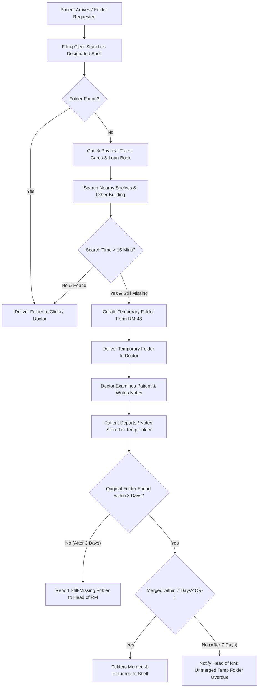

# Part B.1: AS-IS Operational Flowmap

**Case Code:** KJ101-02  
**Hospital:** RS Islam Al-Hikmah, Bogor  
**Version:** v1.1 (Updated for CR-1 on 13 November 2026)  

---

## 1. Description of Work Process & Escalation Rules

Currently, at RS Islam Al-Hikmah, Bogor, when a patient arrives for an outpatient or inpatient appointment:
1. **Initial Search:** The filing clerk (e.g., Mas Andi or Joko) searches for the patient's medical record folder on its designated shelf in the central archive.
2. **Secondary Check:** If the folder is missing from the shelf, the clerk checks physical tracer cards and the physical paper loan book to see if the file was borrowed by another unit or building.
3. **Nearby Search:** The clerk searches nearby shelves for wrongly filed folders.
4. **Search Decision Point (15 Minutes):**
   - If found within 15 minutes, the folder is delivered to the clinic.
   - If **not found after 15 minutes**, the filing clerk creates a **Temporary Folder** (Form RM-48) so the patient can be examined by the doctor without further delay.
5. **Care Delivery:** The doctor sees the patient using the temporary folder and writes clinical notes in it.
6. **Missing Folder Escalation (3 Days):** If the original folder is still not found within **3 days** (per SPO RM-48 & voice note), it is reported to the Head of Medical Records.
7. **Temporary Folder Merge & 7-Day Rule (CR-1):**
   - Per **CR-1**, temporary folders must be merged with the original folder within **7 days**.
   - If a temporary folder remains unmerged after **7 days**, the Head of Medical Records is notified.

---

## 2. Flowmap Diagram (Mermaid)

