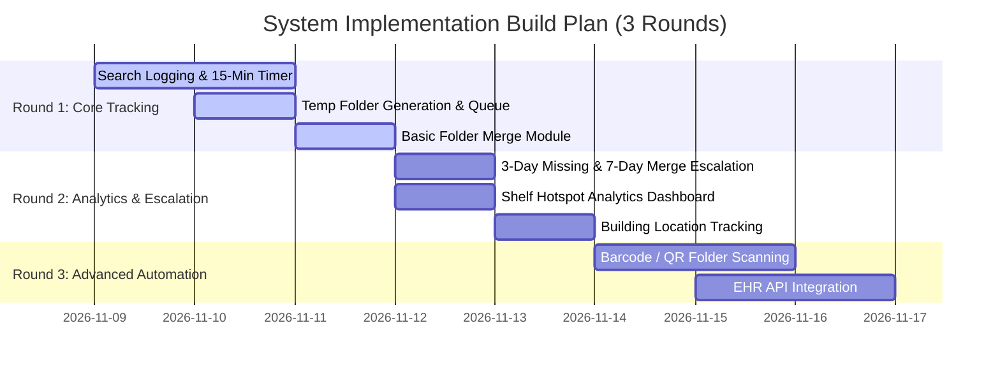

# Part C.2: Data Link Table & 3-Round Build Plan

**Case Code:** KJ101-02  
**Hospital:** RS Islam Al-Hikmah, Bogor  
**Version:** v1.1 (Updated for CR-1 on 13 November 2026)  

---

## 1. Data Ownership Link Table

| Data Item / Attribute | Source System / Person | Data Owner (Role) | Database Table / Storage | Read Access | Write Access |
|---|---|---|---|---|---|
| `rm_number` | EHR / Registration System | Registration Staff | `PATIENT` | All Roles | Registration Staff |
| `patient_name` | EHR / Registration System | Registration Staff | `PATIENT` | All Roles | Registration Staff |
| `search_start_time` | Filing Clerk Form Input | Filing Clerk (Joko/Andi) | `MISFILE_LOG` | All Roles | Filing Clerk |
| `initial_shelf_searched` | Physical Archive Shelf | Filing Clerk | `MISFILE_LOG` | Filing Clerk, Head | Filing Clerk |
| `temp_folder_id` | System Auto-Generator | System / Filing Clerk | `TEMPORARY_FOLDER` | All Roles | System / Filing Clerk |
| `merge_due_timestamp` | System Auto-Generator (+7 Days, CR-1) | System Engine | `TEMPORARY_FOLDER` | All Roles | System Engine |
| `found_shelf_id` | Physical Search Finding | Filing Clerk (Mbak Rini) | `SHELF_LOCATION` | All Roles | Filing Clerk |
| `building_location` | Inter-Building Courier | Filing Clerk / Courier | `MISFILE_LOG` | All Roles | Filing Clerk / Courier |
| `escalation_flag` | System Cron Job (>3 Days Missing / >7 Days Unmerged) | System / Head of RM | `MISFILE_LOG` | Head of RM, Admin | System |
| `merged_timestamp` | Physical Merge Verification | Senior Filing Clerk (Mira) | `TEMPORARY_FOLDER` | All Roles | Senior Filing Clerk |
| `doctor_queue_status` | Aggregated System View | System Engine | Dynamic View (`vw_doctor_status`) | Doctor (Read-Only) | System Engine |

---

## 2. 3-Round Build Plan

### Round 1: Core Tracking & Temporary Folder Management (Delivered in v1.0 - Wednesday 11 Nov)
* **Deliverables:**
  * Digital search logging web interface for filing clerks (RM No, Patient Name, Initial Shelf).
  * Automated 15-minute timer triggering Temporary Folder ID creation (`TEMP-XXXXXX`).
  * Basic folder status tracking (`SEARCHING`, `TEMP_ACTIVE`, `FOUND`, `MERGED`).
  * Manual folder merge interface for filing clerks.
  * Read-only queue monitor for doctor workstations (zero typing).
* **What Waits:** Automated escalations, shelf analytics dashboard, barcode scanning.

### Round 2: Escalation Engine & Shelf Hotspot Analytics (Delivered in v1.1 - Friday/Saturday 13–14 Nov)
* **Deliverables:**
  * Automated **3-day (72-hour)** escalation cron job for still-missing folders.
  * Automated **7-day (168-hour)** merge-overdue escalation cron job for unmerged temporary folders (**CR-1**).
  * Shelf Misfile Hotspot Analytics Dashboard (ranking shelves like Shelf 54 with highest misfile counts).
  * Inter-building physical location tagging (Building A vs. Building B).
* **What Waits:** Hardware barcode scanners, direct EHR database integration.

### Round 3: Advanced Automation & Integration (Future Enhancements)
* **Deliverables:**
  * Mobile barcode/QR scanner integration for instant folder scanning on archive shelves.
  * Real-time bi-directional API integration with hospital EHR registration system.
  * Automated SMS/WhatsApp notification to filing clerks when urgent folder requests arrive.
